# AI Studio: Flow

This file shows how the system works, step by step, with diagrams.
Read it after `HANDOFF.md`. For tables and SQL details, see `docs/DEVELOPER_VIEW.md`.

Diagrams use Mermaid syntax. They show in GitHub, VS Code (Mermaid preview), and many Markdown viewers.

---

## 1. Big picture

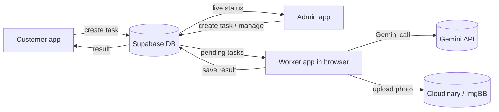

**In one line:** the customer or admin creates a task in the database. A worker picks it up, makes the photo or text,
uploads the photo, and saves the result. The customer sees the result.

---

## 2. Who does what

| Actor | Does | Does not do |
|---|---|---|
| Customer | Picks a feature, uploads photos, writes a prompt, sees own results | Set prices, change prompts, see other customers |
| Admin | Turns features on or off, sets tools and worker jobs, edits prompts, roles, models, settings, alerts | Make photos directly |
| Worker (browser tab) | Takes tasks, calls Gemini, checks face, cuts or edits, compresses, uploads, saves | Decide business rules (the DB decides) |
| Database | Stores everything, checks rules, gives the right tasks to the right worker | Call Gemini or upload photos |

---

## 3. Customer flow

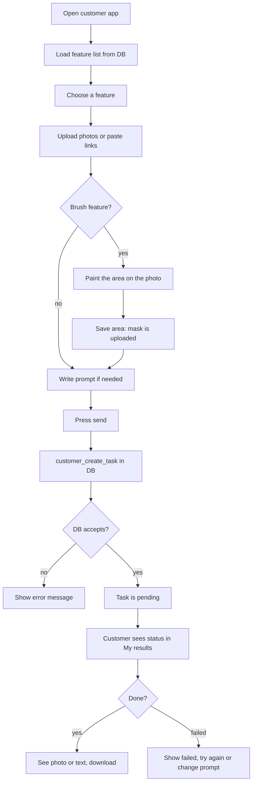

**What the DB checks when the customer presses send:**
1. Customer is logged in.
2. Maintenance mode is off.
3. The feature is enabled and visible to customers.
4. The model is enabled.
5. Daily task limit is not reached.
6. Photos match the feature (how many, which slots, family 2 to 6, per-photo 1 to 10).
7. Prompt is filled when the feature needs one.
8. No identical task is already pending or running.

---

## 4. Admin flow

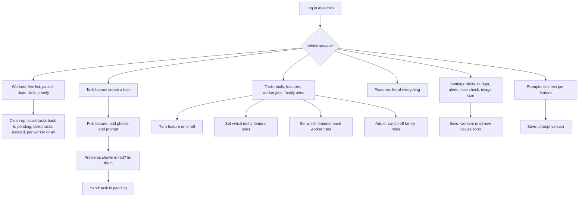

**Admin alerts (automatic, by the DB every minute):**
- All workers offline and tasks pending: email.
- Queue is full: email.
- A worker paused itself: email.
- Same alert is not sent again within the cooldown time.

---

## 5. Worker flow (what the browser tab does)

```mermaid
flowchart TD
    A[Open worker app, enter Gemini key] --> B[Register worker id]
    B --> C[Load config, task types, prompts, roles, models]
    C --> D[Heartbeat (time from settings, default 20 s): I am alive]
    D --> E{Paused or drained or no budget?}
    E -- yes --> D
    E -- no --> F[Ask DB for pending tasks for my tools and types]
    F --> G{Any task?}
    G -- no --> D
    G -- yes --> H[Claim one task: DB gives it only to me]
    H --> I{Claim OK?}
    I -- no --> F
    I -- yes --> J[Run the task]
    J --> K{Success?}
    K -- yes --> L[Save result: photo links or text]
    K -- no --> M{Attempts left?}
    M -- yes --> N[Set to retry later]
    M -- no --> O[Mark failed, save error]
    N --> D
    O --> D
    L --> D
```

### 5.1 What "run the task" does (photo tasks)

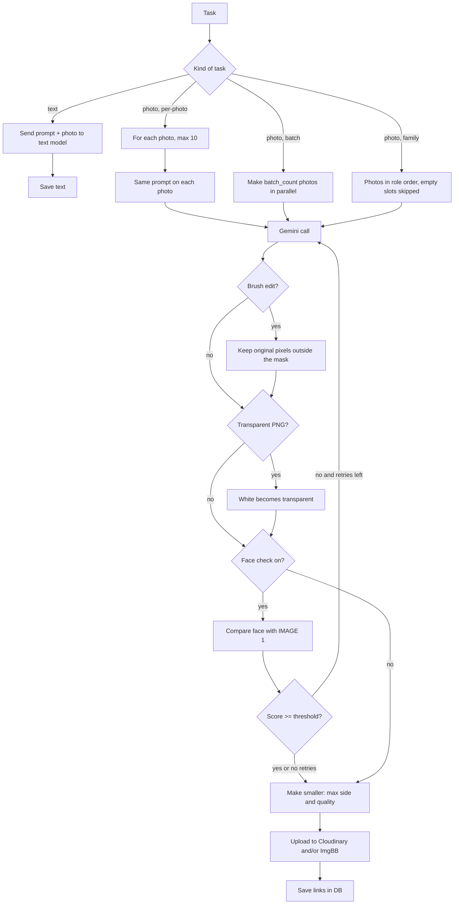

**Rules that always apply:**
- A worker can only take tasks of its own tools and task types (checked in the DB).
- One task is given to one worker only (claim).
- A worker stops taking new tasks when paused, drained, out of budget, or when the model list is not loaded yet.

---

## 6. Database flow (automatic rules)

### 6.1 When a task is created

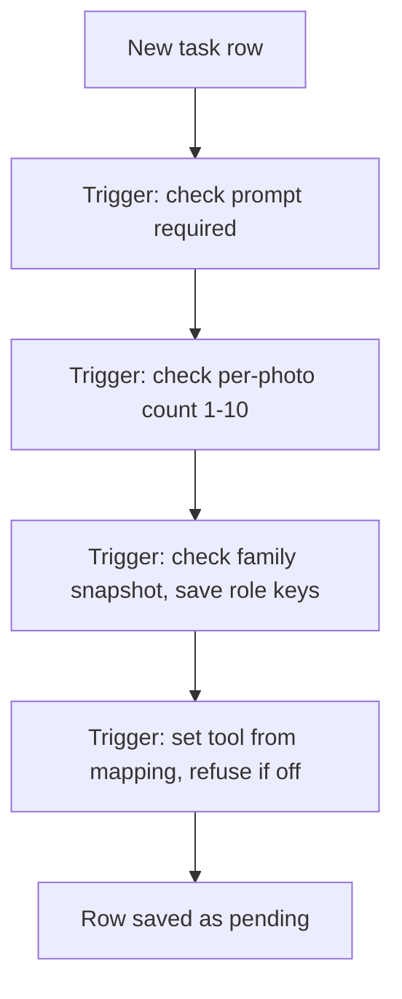

### 6.2 When a worker takes a task

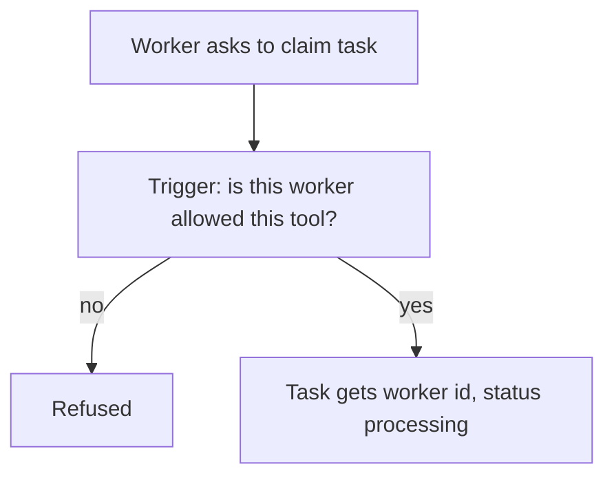

### 6.3 Upload check (before saving a task)

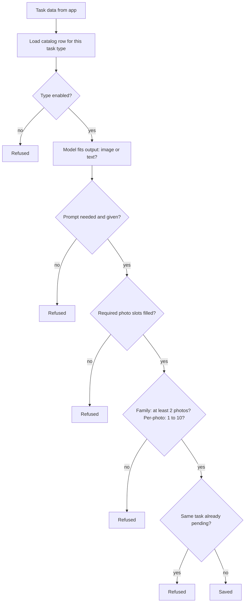

---

## 7. Adding a new feature (flow)

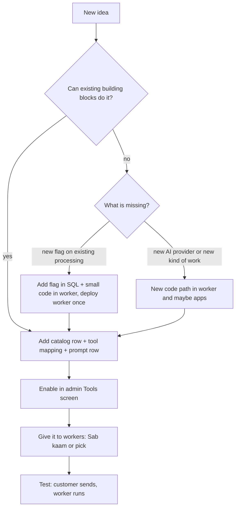

**Building blocks (what catalog rows can use):**
- Photo slots: face, style, input; optional slots; labels.
- Prompt, IMAGE rules, negative text.
- Brush mask (edit), transparent PNG, product angles, per-photo (1-10), family roles.
- Face check (for single person features).
- Text output (for chat and text tools).

---

## 8. Family photo flow (example of the family roles)

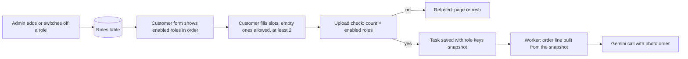

**Why the snapshot:** if roles change later, old tasks still use the roles they were made with.

---

## 9. Email alert flow (Brevo)

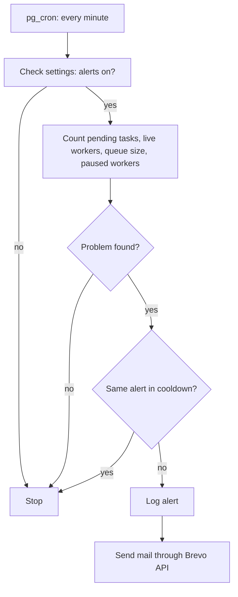

---

## 10. Settings flow (who changes what, and when it takes effect)

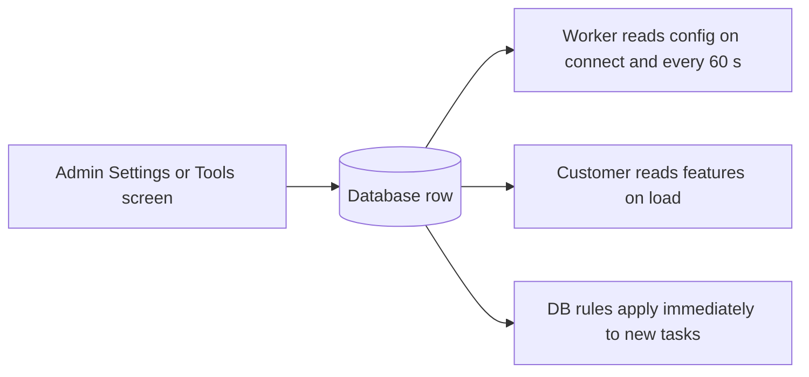

| Change | Where | Takes effect |
|---|---|---|
| Feature on or off | Tools screen | New tasks, next customer page load |
| Prompt text | Prompts | New tasks use the new version |
| Family role | Tools screen | Next family task |
| Worker jobs | Tools screen | Next time the worker asks for tasks |
| Face threshold, image size | Settings | Next worker config refresh |
| Model on or off | Models | Next worker config refresh |

---

## 11. Failure flow

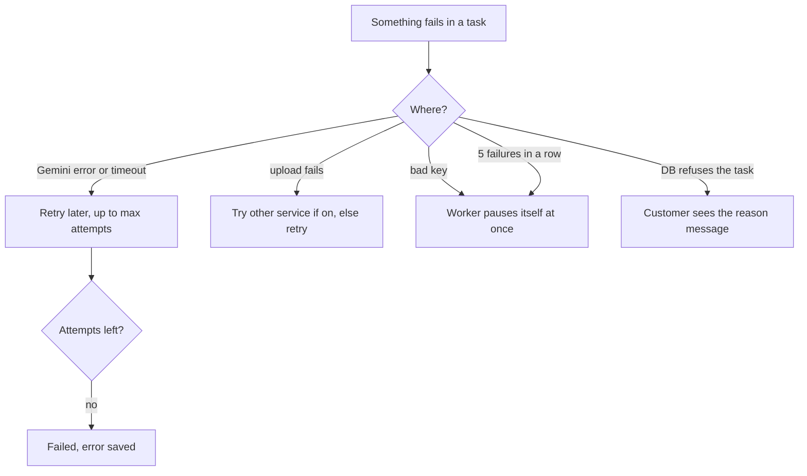

---

## 12. Glossary (short)

| Word | Meaning |
|---|---|
| Feature / task type | One kind of work the customer can ask for (for example "hair change") |
| Catalog | The table of all features and their rules |
| Tool | A group of work (chat or image). Workers have tools. |
| Slot | A photo place in a form (face, style, input, or a family role) |
| Prompt | The instruction text for Gemini, stored in the DB |
| Mask (brush) | The painted area; only this area changes |
| Claim | A worker taking one task. Only one worker can claim a task. |
| Snapshot | A copy of rules or roles saved with the task |
| Per-photo | One result for each photo, same prompt |
| Heartbeat | "I am alive" signal from a worker, every 20 s |
